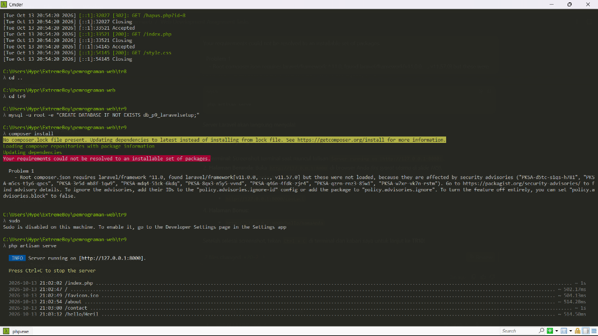
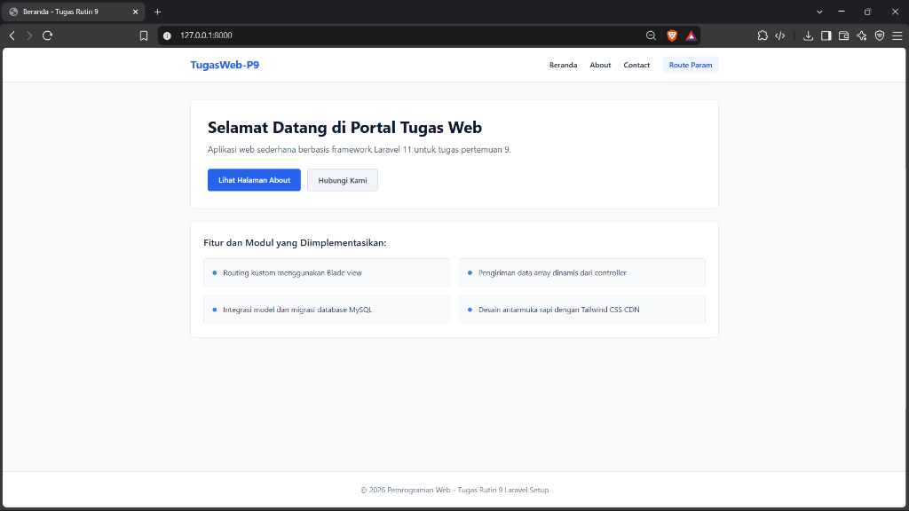
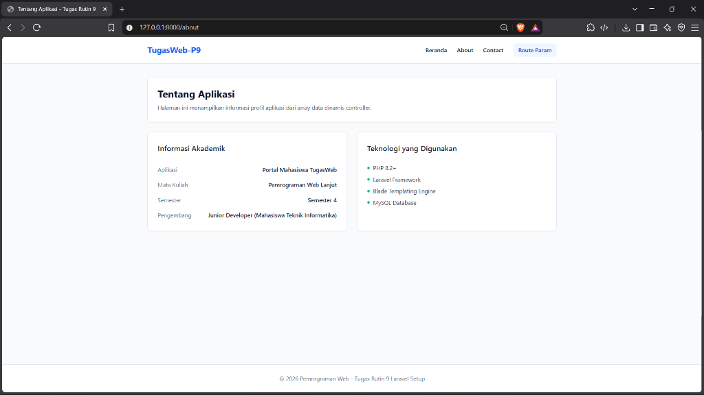
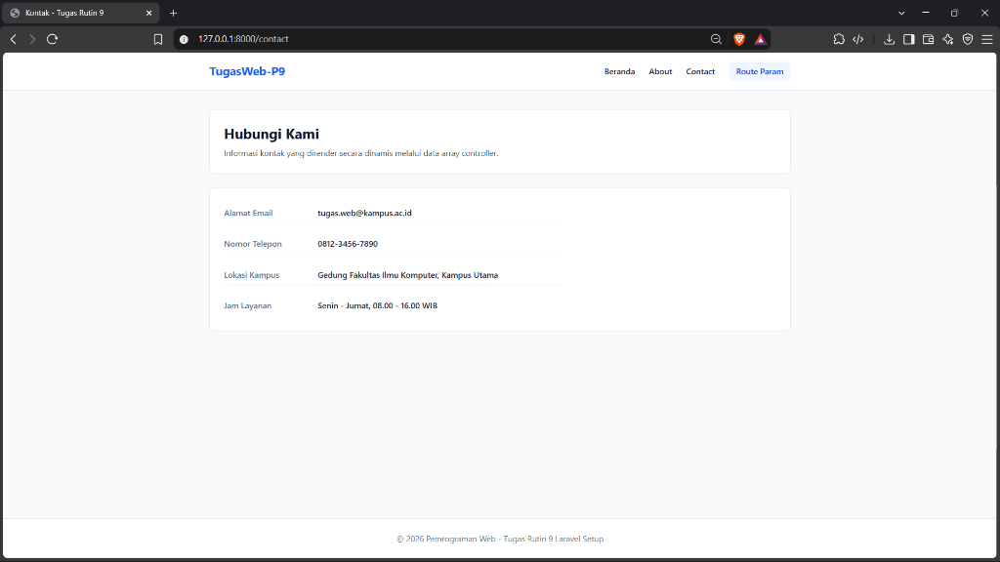
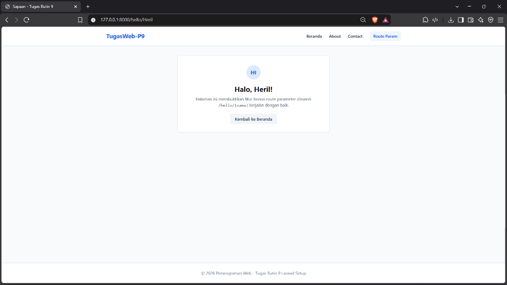

# Portal Informasi Web (Laravel 11)

Aplikasi web sederhana berbasis framework Laravel 11 yang mengimplementasikan sistem templating Blade, pengiriman data dinamis melalui controller, serta pemodelan basis data MySQL.

## Fitur & Halaman

- **Beranda (`/`)**: Menampilkan ringkasan informasi dan sorotan fitur utama aplikasi.
- **Tentang Kami (`/about`)**: Informasi profil pengembang dan tumpukan teknologi yang digunakan.
- **Kontak (`/contact`)**: Informasi komunikasi yang dirender dinamis dari controller.
- **Sapaan Personal (`/hello/{nama}`)**: Demonstrasi penerimaan parameter URL dinamis pada rute Laravel.
- **Model Data**: Entitas `Barang` beserta skema migrasi tabel basis data.
- **Tampilan Responsif**: Antarmuka bersih memanfaatkan utilitas Tailwind CSS via CDN.

## Struktur Direktori Utama

- `app/Http/Controllers/`: Berisi `PageController.php` untuk menangani logika halaman dan penyiapan data.
- `app/Models/`: Berisi entitas model `Barang.php`.
- `database/migrations/`: Berkas migrasi tabel `barangs`.
- `resources/views/`:
  - `layouts/app.blade.php`: Berkas tata letak induk.
  - `welcome.blade.php`, `about.blade.php`, `contact.blade.php`, `hello.blade.php`: Halaman antarmuka.
- `routes/web.php`: Pendefinisian rute web aplikasi.

## Tampilan Antarmuka

### 1. Terminal Server Berjalan (`php artisan serve`)


### 2. Halaman Beranda (Welcome Page)


### 3. Halaman Tentang Aplikasi (/about)


### 4. Halaman Kontak (/contact)


### 5. Parameter Rute Dinamis (/hello/{nama})


## Cara Instalasi & Menjalankan

1. Masuk ke direktori proyek:
   ```bash
   cd tr9
   ```

2. Pasang dependensi PHP:
   ```bash
   composer install
   ```

3. Buat basis data MySQL baru bernama `db_p9_laravelsetup` di phpMyAdmin.

4. Buat application key aplikasi jika belum ada:
   ```bash
   php artisan key:generate
   ```

5. Jalankan migrasi tabel ke basis data:
   ```bash
   php artisan migrate
   ```

6. Jalankan server lokal:
   ```bash
   php artisan serve
   ```

7. Buka browser pada alamat `http://127.0.0.1:8000`.
